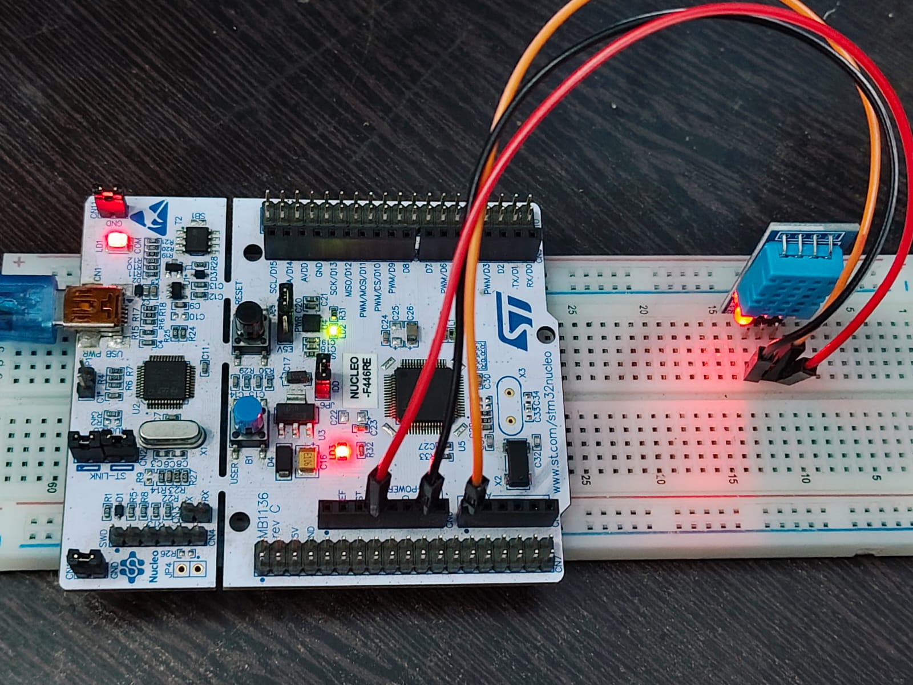
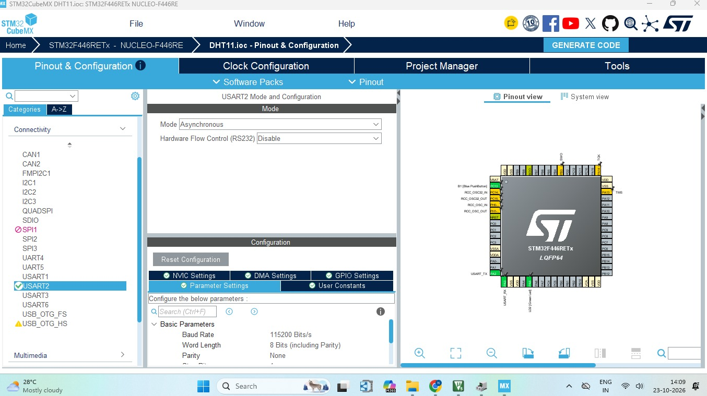
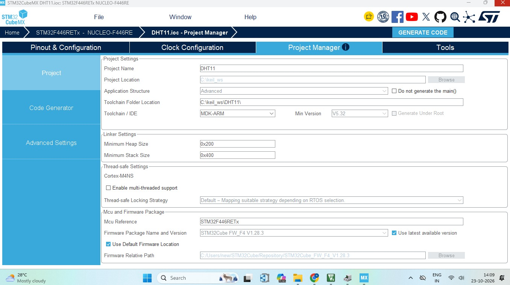
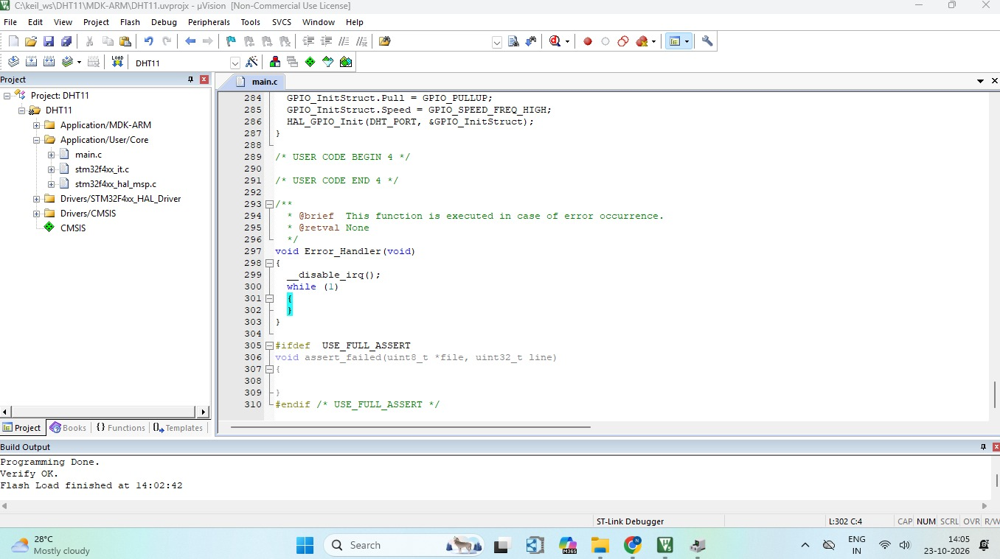

# STM32 NUCLEO-F446RE DHT11 Temperature and Humidity Monitor using Keil MDK

## Project Overview

This project reads **temperature** and **humidity** from a **DHT11** sensor using the **STM32 NUCLEO-F446RE** board and sends the readings to the PC over UART.

The project was configured with **STM32CubeMX** (STM32 HAL library) and built, flashed and run with **Keil MDK (µVision)** and **Arm Compiler 6**.

The DHT11 uses a single-wire protocol with strict microsecond timing. A microsecond delay is created with the Cortex-M4 **DWT cycle counter**, so no hardware timer is needed. The readings are shown in a **PowerShell** window through the ST-LINK Virtual COM Port. The on-board LED (**LD2**) toggles after every successful reading.

## Key Features

- STM32 NUCLEO-F446RE board
- DHT11 temperature and humidity sensor on a single data pin (PA0)
- Bit-level DHT11 protocol implemented in software
- Microsecond delay using the DWT cycle counter (no timer needed)
- Checksum verification of every reading
- Error codes sent over UART for easy troubleshooting
- LD2 blinks on every successful reading
- UART output at 115200 baud read in PowerShell, no extra terminal software needed
- Keil MDK (µVision) with Arm Compiler 6
- Programming and debugging through the on-board ST-LINK

## Hardware Required

| Component | Quantity |
| --- | --- |
| STM32 NUCLEO-F446RE board | 1 |
| DHT11 sensor module (3-pin: VCC, GND, DATA) | 1 |
| Jumper wires | 3 |
| USB cable (data cable) | 1 |

## Circuit Connections

| DHT11 Pin | NUCLEO-F446RE Pin |
| --- | --- |
| VCC | 3V3 |
| GND | GND |
| DATA | PA0 (A0) |

### Project Setup



## System Architecture

```
DHT11 Sensor
     ↓ (DATA, single wire)
GPIO Pin PA0
     ↓
STM32F446RE Microcontroller
     ↓
USART2 (PA2 TX / PA3 RX)
     ↓
ST-LINK Virtual COM Port
     ↓
PC (PowerShell, COM26)
```

## Pin Configuration

| Signal | MCU Pin | Mode |
| --- | --- | --- |
| DHT11 DATA | PA0 | GPIO Output Open-Drain with pull-up |
| LD2 (green user LED) | PA5 | GPIO_Output |
| UART TX to PC | PA2 | USART2_TX |
| UART RX from PC | PA3 | USART2_RX |

PA0 is set as an open-drain output with a pull-up. Writing 1 releases the line, so the same pin can send the start signal and also read the sensor response.

## STM32CubeMX Configuration

1. Create a new project and select the **NUCLEO-F446RE** board in the Board Selector.
2. Initialize all peripherals with their default mode.
3. Check that **PA5** is set as `GPIO_Output` and labeled `LD2`.
4. Set **PA0** as `GPIO_Output` with output type **Open Drain** and **Pull-up**.
5. Enable **USART2** in Asynchronous mode (PA2 as TX, PA3 as RX) with a baud rate of **115200**.
6. In Project Manager, set the toolchain / IDE to **MDK-ARM**.
7. Click **Generate Code**.

### Pinout & Configuration



### Project Manager



## Keil Project Setup

1. Open the generated `.uvprojx` file from the `MDK-ARM` folder in **Keil µVision**.
2. Check that the device is **STM32F446RETx**.
3. Select **Arm Compiler 6** in `Options for Target → Target`.
4. In `Options for Target → Debug`, select **ST-Link Debugger**.
5. In `Options for Target → Debug → Settings → Flash Download`, enable **Reset and Run**.
6. Add your code to `main.c`, then build and download the program.

## Code

The program is written in `main.c`. The Keil window with the source code and the program loaded into flash is shown below.

### Keil main.c and Flash Loaded



## Working

The program follows these steps:

1. Initialize the GPIO pins, USART2 and the DWT cycle counter, then send `DHT11 reading started` to the PC.
2. Wait 1.5 seconds, because the DHT11 needs about 1 second after power up.
3. Send the **start signal**: pull DATA low for 20 ms, then release the line.
4. Wait for the sensor response (low, then high), then read **40 bits**. A high pulse longer than about 40 µs is read as `1`, and a shorter one as `0`. Interrupts are disabled during this timing-critical part.
5. Verify the **checksum** (the sum of the first four bytes must equal the fifth byte).
6. On success, send the temperature and humidity to the PC and toggle LD2. On failure, send an error code.
7. Wait 2 seconds and repeat.

```
Start signal → Sensor response → 40 data bits → Checksum → UART output → LD2 toggle → wait 2 s → repeat
```

### Data Format

| Byte | Content |
| --- | --- |
| 0 | Humidity (integer part) |
| 1 | Humidity (decimal part, always 0 for DHT11) |
| 2 | Temperature (integer part) |
| 3 | Temperature (decimal part, always 0 for DHT11) |
| 4 | Checksum |

The DHT11 gives whole numbers only.

### Error Codes

| Code | Meaning |
| --- | --- |
| 1 | No low response from the sensor |
| 2 | No high response from the sensor |
| 3 | First data bit did not start |
| 4 | Timeout while waiting for a bit to start |
| 5 | Timeout while waiting for a bit to end |
| 6 | Checksum mismatch |

## Serial Output

The ST-LINK on the Nucleo board provides a Virtual COM Port, so no extra USB-to-serial adapter is needed. Check the COM port number in **Device Manager** (this project used **COM26**).

Run this command from the Windows Run dialog (`Win + R`) or Command Prompt to open a PowerShell window that stays open:

```powershell
powershell -NoExit -Command "$p=new-object System.IO.Ports.SerialPort COM26,115200,None,8,one; $p.Open(); while($true){$p.ReadLine()}"
```

If you are already inside a PowerShell window, run only the inner part:

```powershell
$p=new-object System.IO.Ports.SerialPort COM26,115200,None,8,one; $p.Open(); while($true){$p.ReadLine()}
```

| Setting | Value |
| --- | --- |
| Port | COM26 (change to match your PC) |
| Baud rate | 115200 |
| Data bits | 8 |
| Parity | None |
| Stop bits | 1 |

Press `Ctrl + C` to stop reading. Run `$p.Close()` before opening the port again.

## Output

The PowerShell window shows a start message, then a new reading every 2 seconds. LD2 on the board toggles after each successful reading.

Message format:

```
DHT11 reading started
Temperature: <value> C   Humidity: <value> %
```

If the sensor cannot be read:

```
DHT11 error code: <code> (check wiring)
```

### PowerShell Serial Output


## How to Run

1. Connect the DHT11 to the board as shown in the circuit connections.
2. Connect the board to the PC with a USB cable.
3. Open the `.uvprojx` file in **Keil µVision**.
4. Build the project with **F7**.
5. Download the program to the board with **F8**.
6. Press the black **Reset** button if the program does not start.
7. Open PowerShell and run the serial command above.

## Testing

| Test | Result |
| --- | --- |
| Build in Keil (Arm Compiler 6) | Successful |
| Flash through ST-LINK | Successful |
| DHT11 start signal and response | Working |
| Checksum verification | Passed |
| Temperature and humidity in PowerShell | Working |
| LD2 toggles on each good reading | Working |

## Important Notes

### Jumpers

Both **CN2** jumper caps on the board must be fitted. If they are missing, the programmer cannot connect to the chip.

### Sensor Timing

The DHT11 can be read only once every 1 to 2 seconds, and it needs about 1 second after power up. Reading it faster gives errors.

### Regenerating Code in CubeMX

If you regenerate the code, set PA0 as **Open Drain with Pull-up** in CubeMX. Otherwise the sensor will not respond. Check that your own code is still inside the `USER CODE BEGIN` and `USER CODE END` blocks.

### Error Code Troubleshooting

Errors 1 to 3 usually mean a wiring problem (DATA on the wrong pin, loose jumper wire, or no power to the sensor). Error 6 usually means a noisy connection, so use shorter wires.

### COM Port

The COM port number can change between PCs or USB ports. Always check Device Manager before running the PowerShell command.

### One Program at a Time

Only one program can use the COM port at once. Close any other serial terminal before running the PowerShell command.

### USB Cable

Use a data-capable USB cable. Some cables only charge.

## Technologies and Concepts

- STM32 NUCLEO-F446RE
- STM32CubeMX
- Keil MDK (µVision)
- Arm Compiler 6
- STM32 HAL library
- DHT11 single-wire protocol
- GPIO open-drain input/output
- DWT cycle counter microsecond delay
- UART communication
- ST-LINK Virtual COM Port
- PowerShell serial reading
- ST-LINK programming and debugging

## Future Improvements

- Show temperature and humidity on a 16×2 I2C LCD
- Add a temperature threshold alert using the LEDs
- Timer-based sampling without HAL_Delay
- Send the readings to a mobile app or IoT dashboard
- Upgrade to a DHT22 sensor for decimal readings
